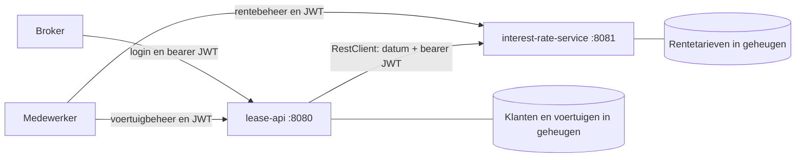

# Keuzes voor Lease-a-car

[Open de backlog](backlog.html) · [Opdracht](assessment.md) · [Analyse](analyze.md) · [Voertuigen](../data/testdata.csv) · [Rente](../data/testdata_interest.csv)

De opdracht bepaalt wat verplicht is; mijn analyse is ontwerpadvies. Deze keuzes vullen ontbrekende details in voor de
eenvoudigste uitvoerbare versie.
Demo-login met JWT en bouwen in Docker zijn expliciet door mij gekozen.
Bij het rekenverschil bij Leaserate (voorbeeld vs formule), heb ik gekozen om de formule leidend te laten zijn, want dit
is makkelijker te implementeren, tevens is dat ook duidelijker voor andere developers die werk overnemen.

## Doel en grens

Een broker logt in, beheert klanten en berekent een maandbedrag voor een voertuig en contract. Een medewerker beheert
voertuigen en gedateerde rentetarieven. Twee zelfstandig draaiende services voeren de berekening via een echte
HTTP-aanroep uit. Alle zakelijke endpoints valideren een JWT.

Stories beschrijven het implementatiewerk.

## Bronfeiten

| Bron                                                   | Gecontroleerd feit                                                                                                    | Gevolg                                                                      |
|--------------------------------------------------------|-----------------------------------------------------------------------------------------------------------------------|-----------------------------------------------------------------------------|
| [assessment.md](assessment.md)                         | Java 21+, Spring Boot 3.x/4.x, REST, servicecommunicatie, tokens, unit tests, Javadoc en Google Java Style verplicht. | Opgenomen in verplichte stories en oplevercriteria.                         |
| [analyze.md](analyze.md)                               | Twee services, RestClient en Java-repositories in geheugen aanbevolen.                                                | Baseline overgenomen.                                                       |
| [testdata.csv](../data/testdata.csv)                   | 10.329 datarijen, 47 merken, 7 kolommen; geen lege velden.                                                            | Geautomatiseerde importcontrole met vaste aantallen.                        |
| [testdata.csv](../data/testdata.csv)                   | 320 identieke extra rijen; 1.453 extra rijen delen merk/model/versie.                                                 | Eigen ID per rij; geen deduplicatie op naam.                                |
| [testdata.csv](../data/testdata.csv)                   | Puntkomma, decimale komma, niet geldig als UTF-8. `hp` aanwezig, CO₂ ontbreekt.                                       | Expliciete decodering en mapping; geen verzonnen uitstoot.                  |
| [testdata_interest.csv](../data/testdata_interest.csv) | 20 tarieven, unieke ingangsdatums, van 2014-05-01 tot 2019-08-15; rente van −0,75% tot 4,75%.                         | Negatieve rente is geldig; selecteer historisch per datum.                  |
| Bestaande `pom.xml`                                    | Java 21 en Spring Boot 4.0.8, met extra UI-, database- en authorization-serverdependencies.                           | Bestaande versiebasis behouden; dependencies gericht vereenvoudigen in S02. |

>De voertuigbytes bevatten geen waarden in 0x80–0x9F. Windows-1252 en ISO-8859-1 leveren voor dit bestand dezelfde tekst
op. Windows-1252 is daarom een expliciete leeskeuze, geen bewezen oorspronkelijke encoding.


## Architectuur en contracten



`lease-api` geeft demo-tokens uit en bezit klanten, voertuigen en berekening. `interest-rate-service` bezit uitsluitend
rentetarieven. Beide services valideren identiteit. Eén repository, twee Maven-modules, twee applicatiecontainers en
geen gedeelde datastore. Een gedeelde codebibliotheek is voor deze omvang niet nodig.

| Contract                                        | Toegang                               | Gedrag                                                                                                     |
|-------------------------------------------------|---------------------------------------|------------------------------------------------------------------------------------------------------------|
| `POST /auth/login`, lease-api                   | Anoniem                               | Credentials naar kortlevend JWT; foutieve credentials geven 401.                                           |
| `/customers` en `/customers/{id}`               | BROKER                                | GET lijst/detail, POST, PUT, DELETE.                                                                       |
| `/vehicles` en `/vehicles/{id}`                 | BROKER leest; EMPLOYEE leest/schrijft | GET lijst/detail, POST, PUT, DELETE.                                                                       |
| `/interest-rates` en `/interest-rates/{id}`     | BROKER leest; EMPLOYEE leest/schrijft | GET lijst/detail, POST, PUT, DELETE.                                                                       |
| `GET /interest-rates/effective?date=YYYY-MM-DD` | BROKER of EMPLOYEE                    | Meest recente ingangsdatum die niet na de gevraagde datum ligt.                                            |
| `POST /lease-quotes`, lease-api                 | BROKER                                | `{vehicleId, mileage, duration, startDate}` naar maandbedrag, gebruikte nettoprijs, rente en ingangsdatum. |

JSON gebruikt decimale punten en ISO-datums; alleen de CSV-adapter leest Nederlandse notatie. Quote-response bevat
`monthlyRate`, `currency: "EUR"`, `nettPrice`, `interestRate`, `interestStartDate`, plus de vier invoervelden. Quotes
worden niet opgeslagen. Klant-ID is niet nodig voor de formule en blijft buiten het rekencontract.

## Besluitenregister

<a id="k01"></a>

### K01 · Eerst de verplichte API

**Keuze.** Elf verplichte stories, gevolgd door twee losse bonusstories. Docker is volgens mijn persoonlijke werkwijze onderdeel van de
basis: bouwen, testen en starten vanuit een schone checkout zonder lokaal geïnstalleerde Java of Maven. Geen
applicatiefrontend, contractbeheer, facturatie, refresh tokens of zoekplatform.

**Waarom.** De opdracht beoordeelt een eenvoudige API. Extra productfuncties kosten tijd zonder een ontbrekende eis af
te dekken. "backlog" is een planningshulpmiddel, geen onderdeel van de API.

**Afweging.** Een uitgebreid portaal oogt compleet maar vertraagt bewijs van de kern. Bonuswerk start pas na een
geslaagde verplichte oplevering.

**Toets en teruglink.** [S01](backlog.html#S01), [S10](backlog.html#S10), [scope](backlog.html#scope).
Bron: [opdracht](assessment.md).

<a id="k02"></a>

### K02 · Twee services, één repository

**Keuze.** `lease-api` voor klanten, voertuigen, login en quotes; `interest-rate-service` voor rente. Maven-parent met
twee modules en afzonderlijk startbare JARs. S02 legt de Docker-buildstage vast; S11 voegt twee runtime-targets en
Compose toe.

**Waarom.** Dit is de kleinste duidelijke splitsing die echte service-to-servicecommunicatie toont en overeenkomt met de
analyse.

**Afweging.** Een monoliet mist de expliciete communicatie-eis. Een aparte service per entiteit geeft extra configuratie
en foutpaden. Controller → service → concrete repository volstaat; geen generiek repositoryframework of gedeelde
domeinmodule.

**Toets en teruglink.** [S02](backlog.html#S02), [S07](backlog.html#S07): twee processen, afzonderlijke data-eigenaren,
HTTP-aanroep aantoonbaar. Bron: [analyse](analyze.md).

<a id="k03"></a>

### K03 · Bestaande Java- en Spring-basis, minimale dependencies

**Keuze.** Java 21, Spring Boot 4.0.8 en Maven Wrapper uit het project behouden. Records voor DTO's, Bean Validation en
constructorinjectie. Behoud Web MVC, Security en Resource Server; voeg Validation toe. Gebruik Boot 4-teststarters
passend bij MVC en Security. 

**Waarom.** Geen migratie nodig. De starter-BOM beheert compatibele versies. Dependency-resolutie en tests bewijzen in
S02 dat de gekozen modules samen werken.

**Afweging.** Verwijder bij implementatie ongebruikte Thymeleaf/HTMX, Lombok, H2/H2-console, authorization-server en
bijbehorende testdependencies. Swagger hoort bij bonuswerk; Docker is verplicht via S02/S11 en keuze K20. Actuator,
DevTools en Testcontainers zijn geen vereiste voor de basis. Voeg één CSV-parser, Apache Commons CSV, toe bij S09;
quoted velden maken handmatig splitsen kwetsbaar. Deze documenten wijzigen het bestaande POM niet.

**Toets en teruglink.** [S02](backlog.html#S02), [S09](backlog.html#S09): minimale build met JDK 21 in Docker, beide
services startbaar. Bron: [analyse](analyze.md) en bestaande projectbasis.

<a id="k04"></a>

### K04 · Duurzame opslag per service

**Keuze.** Kleine concrete JDBC-repositories met gegenereerde UUID's en één H2-database in file-mode per service. Een
unieke databaseconstraint bewaakt rentedatums; lezen selecteert de laatste toepasselijke datum. Compose koppelt aan elke
service een eigen named volume.

**Waarom.** Dit is de kleinste duurzame invulling van B03. JDBC en expliciet SQL behouden het bestaande domein- en
API-contract zonder ORM of gedeelde database.

**Afweging.** Schema-initialisatie gebruikt idempotent `schema.sql`; een aparte migratietool is voor deze lokale
assessment niet nodig. H2 file-mode is niet bedoeld voor meerdere gelijktijdige service-instances. Lokale bestanden
staan onder `./data/`; Compose-data blijft in named volumes. Er is geen reset-endpoint: alleen `docker compose down -v`
wist beide volumes.

**Toets en
teruglink.** [S04](backlog.html#S04), [S05](backlog.html#S05), [S08](backlog.html#S08), [B03](backlog.html#B03).
Bron: [opdracht](assessment.md), [analyse](analyze.md).

<a id="k05"></a>

### K05 · Demo-login met JWT


**Keuze.** Eén `POST /auth/login` in lease-api. Twee geconfigureerde demo-accounts met rollen BROKER en EMPLOYEE. Spring
Security verifieert BCrypt-passwordhashes; Spring JWT-ondersteuning geeft HS256-tokens uit. Geldigheid 15 minuten. Beide
services valideren handtekening, vast algoritme, issuer, audience, expiry en eventuele not-before. Verwachte issuer
`lease-demo`, audience `lease-platform`.

**Waarom.** Voldoet aan login en tokenvalidatie zonder een derde proces of volledige authorization-server.

**Afweging.** Dit is een demo-login, geen volledige OAuth2- of OIDC-provider. Een gedeeld HMAC-secret is eenvoudiger dan
sleutelrotatie, maar geeft beide services technisch de mogelijkheid tokens te ondertekenen. Het secret is minimaal 256
bit en komt, net als accountconfiguratie, uit de omgeving. Geen echte credentials of werkende secrets in Git; README
bevat instructies om demo-waarden te maken. Alleen voor lokale assessmentuitvoering; extern verkeer vereist HTTPS.
Vernieuwen gebeurt door opnieuw in te loggen.

**Toets en teruglink.** [S03](backlog.html#S03): ontbrekende, verlopen, vervalste en verkeerd geadresseerde tokens geven
401 bij beide services. Bron: [opdracht](assessment.md) en gebruikerskeuze.

<a id="k06"></a>

### K06 · Twee rollen en een expliciete rechtenmatrix

**Keuze.** BROKER beheert klanten, leest voertuigen/rente en vraagt quotes. EMPLOYEE beheert voertuigen/rente. EMPLOYEE
krijgt geen klantbeheer of quote-recht. Autorisatie gebeurt op de server.

**Waarom.** Sluit aan op de twee gebruikersgroepen uit de opdracht, met eenvoudig toetsbaar gedrag.

**Afweging.** Geen gebruikersbeheer, organisatiegrenzen of toestemming per individueel klantrecord. Dat staat niet in de
assessment. Geldig token zonder benodigde rol geeft 403; ongeldig token geeft 401. Alleen login is anoniem.

**Toets en
teruglink.** [S03](backlog.html#S03), [S04](backlog.html#S04), [S05](backlog.html#S05), [S08](backlog.html#S08).
Bron: [opdracht](assessment.md); precieze rollenmatrix is een ontwerpaanname.

<a id="k07"></a>

### K07 · Synchrone HTTP-aanroep met RestClient

**Keuze.** lease-api vraagt rente per contractstartdatum op via RestClient. Bearer-token wordt alleen doorgestuurd naar
de geconfigureerde interest-rate-service. Beide services vertrouwen dezelfde issuer/audience. Connect-timeout 1 seconde,
read-timeout 2 seconden; geen retries, fallbackrente of cache.

**Waarom.** Eén leesaanroep per quote is voldoende. De synchrone Spring-client sluit aan op MVC en vermijdt extra
frameworks.

**Afweging.** Uitval van de renteservice verhindert quotes en geeft 503. Een geldige datum zonder historisch tarief
geeft 422 bij de quote; de renteservice geeft daarvoor 404. Downstream weigering van een door lease-api geaccepteerd
token of ongeldige downstream-response geeft 502. Foute credentials aan de voordeur blijven 401. Geen gokbedrag bij
storingen. Hostpoorten 8080 en 8081 zijn defaults. In Compose gebruikt lease-api de servicenaam `interest-rate-service`
en diens containerpoort, nooit localhost voor de andere container. De basis-URL is configuratie, nooit requestinvoer.

**Toets en teruglink.** [S07](backlog.html#S07): HTTP-contracttests en een demo met twee echte processen.
Bron: [analyse](analyze.md), [opdracht](assessment.md).

<a id="k08"></a>

### K08 · Geld in BigDecimal, expliciete eenheden

**Keuze.** Kilometerstand betekent kilometers per jaar; duur is een positief geheel aantal maanden. Mileage > 0, duur >
0 en nettoprijs > 0. Rente is een percentage, bijvoorbeeld `4.5`, en mag negatief zijn. Gebruik BigDecimal uit decimale
tekst, `MathContext.DECIMAL128` bij delen en rond alleen het eindbedrag op twee decimalen met `HALF_UP`.

**Waarom.** Geldberekeningen met doubles geven onnodige afrondingsonzekerheid. Expliciete eenheden voorkomen
verwisseling van maand- en jaarwaarden.

**Afweging.** Geen ongevraagde maximale looptijd of kilometergrens. Bruto- en nettoprijs hoeven niet via een
verondersteld btw-percentage te corresponderen. De bronformule kan een negatief maandbedrag geven; geen stilzwijgende
bodem op nul.

**Toets en teruglink.** [S06](backlog.html#S06), [S07](backlog.html#S07).
Bron: [opdracht](assessment.md), [rentedata](../data/testdata_interest.csv).

<a id="k09"></a>

### K09 · Formuleverschil expliciet laten besluiten

**Keuze.** De letterlijk opgegeven formule is leidend. Het voorbeeldbedrag wordt niet met een correctiefactor
nagebootst.

```text
((45000 / 12) * 60) / 63000 + ((4.5 / 100) * 63000) / 12
= 3.571428571... + 236.25
= 239.821428571... → EUR 239.82
```

**Waarom.** De opdracht noemt EUR 239,76, maar dat volgt niet uit de formule. Eén expliciete regel is te testen; twee
tegenstrijdige uitkomsten niet.

**Afweging.** Ook de eerste term is geen gebruikelijke lease-afschrijving. We ontwerpen geen eigen financieel model. De
rekenstory volgt de letterlijke formule. Een unit test bewijst zowel EUR 239,82 als dat EUR 239,76 daarvan afwijkt.
Bevestigt de opdrachtgever later het voorbeeldbedrag, dan moet eerst de formule worden aangepast en dezelfde testset
opnieuw worden vastgesteld.

**Toets en teruglink.** [S01](backlog.html#S01), [S06](backlog.html#S06), [aandachtspunten](backlog.html#aandacht).
Bron: [opdracht](assessment.md).

<a id="k10"></a>

### K10 · Historische rente per contractdatum

**Keuze.** `startDate` is verplicht in de quote. Kies het tarief met de grootste ingangsdatum ≤ startDate. Gebruik
`LocalDate`, geen tijdzone of impliciete vandaag-datum. Geen einddatum nodig; het volgende tarief sluit het vorige af.
Eén tarief per ingangsdatum, ook bij wijzigen; conflicten geven 409.

**Waarom.** Dit maakt offertes reproduceerbaar en benut de aangeleverde historie. Negatieve rente is aantoonbaar
brondata.

**Afweging.** Vóór 2014-05-01 bestaat in het CSV-bestand geen tarief. Na 2019-08-15 geldt volgens dit voorstel 4,35% tot
er een nieuwer tarief komt. Dit is demo-historie, geen bewering over actuele marktrente. Geen externe rentedienst.

**Toets en teruglink.** [S05](backlog.html#S05), [S07](backlog.html#S07), [S09](backlog.html#S09). Datums 2015-02-04 →
1,25%; 2015-02-05 → −0,75%; 2015-02-19 → 1%. Bron: [rentedata](../data/testdata_interest.csv).

<a id="k11"></a>

### K11 · Eenvoudige klant- en voertuigmodellen

**Keuze.** Customer bevat `id`, `name`, `street`, `houseNumber`, `zipcode`, `place`, `email`, `phoneNumber`. Strings
voor huisnummer, postcode en telefoon; alle velden zijn verplicht, niet leeg, e-mail is geldig. Geen Nederlands
postcode- of telefoonpatroon afdwingen. Vehicle bevat `id`, `make`, `model`, `version`, `numberOfDoors`, `co2Emission`,
`grossPrice`, `nettPrice`.

**Waarom.** Huisnummers kunnen letters hebben; telefoonnummers een plus of voorloopnul. Exact de gevraagde
bedrijfsgegevens blijven herkenbaar.

**Afweging.** CO₂ is nullable, in g/km, en bij aanwezigheid ≥ 0. De bron mist dit veld; onbekend is geen nul. Nieuw
ingevoerde voertuigen mogen CO₂ ook leeg laten en medewerkers kunnen het later aanvullen. Merk/model/versie niet leeg,
deuren positief geheel, beide prijzen > 0. `hp` wordt bewust niet onderdeel van het kernmodel en nooit naar CO₂
gekopieerd. Geen verzonnen klantfixtures uit voertuiggegevens; voor de demo één fictieve klant via de API.

**Toets en teruglink.** [S04](backlog.html#S04), [S08](backlog.html#S08), [S09](backlog.html#S09).
Bron: [opdracht](assessment.md), [voertuigdata](../data/testdata.csv). Nullable CO₂ is een expliciete ontwerpaanname.

<a id="k12"></a>

### K12 · Reproduceerbare CSV-import zonder dataverlies

**Keuze.** Laad de twee bestanden één keer bij initialisatie van een nieuwe database. Een persistente seed-marker
voorkomt herimport, ook nadat alle seedrecords zijn verwijderd. Gebruik Commons CSV met puntkomma, quotes en headers.
Voertuigen lezen als Windows-1252; rentedata als UTF-8. Decimale komma omzetten naar punt; datums strikt als `d-M-uuuu`
lezen. Trim omringende witruimte. Mapping: `#doors` → `numberOfDoors`, `gross_price` → `grossPrice`, `nett_price` →
`nettPrice`; rente `interestrate` → `interestRate`, `startdate` → `startDate`.

**Waarom.** Dit importeert de aangeleverde data zonder handmatige opschoning of stil verlies. UUID per voertuigrij
voorkomt overschrijven van gelijknamige of identieke versies.

**Afweging.** Behoud alle 10.329 voertuigregels, inclusief 320 identieke extra rijen. Geen bewezen businesssleutel om
veilig te dedupliceren. Negeer alleen de bekende extra kolom `hp`. Ontbrekende vereiste headers of ongeldige waarden
stoppen import met bestand en rijnummer. Import en seed-marker staan in één transactie. Na herstart blijven IDs en
verwijderingen behouden. Bestanden moeten in de gebouwde applicaties beschikbaar zijn, onafhankelijk van de
werkdirectory.

**Toets en teruglink.** [S09](backlog.html#S09): exact 10.329 voertuigen en 20 tarieven, 0 verloren duplicaten, accenten
behouden, foutieve rij geen gedeeltelijke import. Bron: beide CSV-bestanden.

<a id="k13"></a>

### K13 · Kleine, voorspelbare REST-contracten

**Keuze.** Resource-URL's in meervoud, UUID's als ID en PUT voor volledige wijziging. POST → 201 met Location, GET/PUT →
200, DELETE → 204. Onbekende ID → 404, ongeldige invoer → 400, datumconflict → 409, ontbreken van toepasbare rente bij
quote → 422. Fouten gebruiken Spring ProblemDetail met status en bruikbare melding, zonder stacktrace of credentials.

**Waarom.** Voorspelbare standaardconventies vragen weinig uitleg of maatwerk.

**Afweging.** Lijsten krijgen `page` en `size`, standaard 0 en 50, maximum size 100, met `items`, `page`, `size`,
`total`. Sortering op ID maakt paging binnen een draaiende demo stabiel. De voertuigbron heeft ruim tienduizend regels;
deze kleine begrenzing houdt responses hanteerbaar. Geen PATCH, vrije filters, versieprefix of extra zoektaal. Een quote
haalt nettoprijs uit het voertuig en rente uit de renteservice; de client kan die niet overschrijven.

**Toets en
teruglink.** [S04](backlog.html#S04), [S05](backlog.html#S05), [S07](backlog.html#S07), [S08](backlog.html#S08).
Bron: [opdracht](assessment.md), [voertuigdata](../data/testdata.csv).

<a id="k14"></a>

### K14 · Specification-driven development vóór implementatie

**Keuze.** SDD betekent hier Specification-Driven Development. Elke story bevat gebruiker/doel, contract,
Given/When/Then-criteria, bron, keuzes, afhankelijkheden en bewijs van gereed. Deze twee documenten vormen de kleine
specificatie; geen extra specframework.

**Waarom.** Een opvolgende ontwikkelaar kan gedrag afleiden zonder ontbrekende regels te raden. Tegenstrijdigheden
blijven zichtbaar.

**Afweging.** Voor aannames volstaat een expliciet besluitrecord. Een onopgeloste zakelijke tegenstelling, K09,
blokkeert alleen afhankelijk rekenwerk. Na besluit worden specificatie en tests samen aangepast. Geen implementatie die
vooruitloopt op bonuswensen.

**Toets en teruglink.** [S01](backlog.html#S01), [werkwijze](backlog.html#werkwijze), [dekking](backlog.html#dekking).
Bron: gebruikersverzoek.

<a id="k15"></a>

### K15 · TDD per gedrag, gerichte testlagen

**Keuze.** Eerst een falende gedragstest, dan minimale implementatie, daarna opruimen met groene tests. Pure JUnit-tests
voor formule en renteselectie; MVC/Security-tests voor validatie en rollen; gemockte HTTP-server voor RestClient;
afsluitend een rooktest met beide echte services. Gebruik Boot-beheerde testlibraries. TDD-regels in deze backlog
beschrijven toekomstig werk, geen al geslaagde API-tests.

**Waarom.** Zo worden geldregels, datumgrenzen en beveiliging controleerbaar zonder voor elke test een volledige
infrastructuur te starten.

**Afweging.** Geen willekeurig coveragepercentage of tests van triviale getters. Alle acceptatiecriteria hebben
aantoonbaar bewijs. `docker build --target verify .` wordt het verificatiecommando vanaf de host. In die Docker-stage
draait `./mvnw -B verify` voor beide modules, inclusief integratietests en Google Java Style-controle. Een falende test
stopt de imagebouw. De Maven Wrapper en gepinde Java 21-basisimage bepalen de toolchain; een lokale JDK, Maven of RTK is
geen voorwaarde. Javadoc beschrijft publieke contracten en niet-triviale reken-/datumregels. De build configureert die
controles in S02; ze bestaan nog niet als bewezen groene suite.

**Toets en
teruglink.** [S02](backlog.html#S02), [S06](backlog.html#S06), [S07](backlog.html#S07), [S10](backlog.html#S10).
Bron: [opdracht](assessment.md) en gebruikersinstructies.

<a id="k16"></a>

### K16 · WSJF als relatieve rangorde

**Keuze.** WSJF = (businesswaarde + tijdkritiek + risicoreductie) / omvang. Schaal 1, 2, 3, 5, 8, 13. Hoog is eerder.
Alle scores zijn initiële inschattingen voor deze assessment, geen gemeten bedrijfswaarde of dagen. Verplicht werk gaat
vóór bonuswerk. Afhankelijkheden en gereedheidscriteria gaan vóór score; bij gelijkstand eerst businesswaarde, dan
story-ID.

**Waarom.** Maakt de afweging tussen snelle bewijsvoering en grotere werkzaamheden zichtbaar. Vroege formule- en
beveiligingstests nemen de grootste onzekerheid weg.

**Afweging.** 37 omvangpunten voor de elf verplichte stories en 10 voor bonussen zijn relatieve eenheden. Zonder
deadline of teamsnelheid is een tijdsbelofte niet onderbouwd. Herprioriteer na iedere afgeronde story; wijzig geen
omvang om een gewenste score te krijgen. Zolang K09 openstaat, sla S06 en daarna S07 over en pak gereed klant- of
importwerk op.

**Toets en teruglink.** [prioriteiten](backlog.html#prioriteiten), [route](backlog.html#route). Bron: gebruikersverzoek.

<a id="k17"></a>

### K17 · Bewijsbare oplevering, bonussen apart

**Keuze.** S10 levert README, Docker-/Compose-instructies, voorbeeldrequests, voorbeelddata, testbewijs, beperkingen en
een reproduceerbare demo op een tweede schone Dockeromgeving. Uiteindelijk alle benodigde applicatiecode en assets
pushen naar een persoonlijke Git-repository. B01 Swagger en B03 duurzame opslag zijn optioneel en afzonderlijk te
kiezen. Voormalige bonus B02 is nu verplichte story S11: bouwen en draaien in Docker. Het oude B02-anker verwijst naar
S11.

**Waarom.** De beoordelaar moet kunnen starten, inloggen, beheren en rekenen zonder mondelinge uitleg. De opdracht noemt
publicatie in een Git-achtige repository als deliverable.

**Afweging.** Geen remote of deadline opgegeven; S10 laat remote kiezen en controleert toegang bij oplevering. Deze
documentatietaak pusht niet. Swagger mag de basis niet blokkeren; een databasebonus moet restartbestendigheid bewijzen,
een standaard H2-geheugendatabase doet dat niet. Voor die bonus volstaat H2 in file-mode per service met bestaande
repositorygedragstests en een eigen Docker named volume, zodat data ook containervervanging overleeft.

**Toets en
teruglink.** [S10](backlog.html#S10), [S11](backlog.html#S11), [B01](backlog.html#B01), [B03](backlog.html#B03).
Bron: [opdracht](assessment.md) en gebruikersverzoek om Docker.

<a id="k18"></a>

### K18 · Eén responsive HTML-document

**Keuze.** Zakelijke donkergroene/zandkleurige opmaak, systeemfonts, semantische HTML en ingebedde, gecompileerde
Tailwind CSS 4.3.3. Kleine inline JavaScript-functies voor zoeken, scopefilter, inklappen en afdrukken. Alle inhoud
staat direct in HTML. Relatieve links en stabiele story-/keuzeankers werken in beide richtingen.

**Waarom.** Openen vraagt geen installatie, server, CDN of netwerk. Eén bestand is snel te reviewen en mee te leveren.
Met JavaScript uit blijven inhoud en native details-elementen leesbaar. De pagina staat nergens gepubliceerd.

**Afweging.** De gecompileerde CSS is meegeleverd voor de gebruikte utilityclasses; nieuwe Tailwindclasses vragen
hercompilatie. Behoud de Tailwind-licentieregel. Markdownlinks worden door de gebruikte viewer getoond of als bron
geopend. Ze zijn bewust geen kopie van de documenten. Print toont alle stories, ook na filtering. Responsiveness,
toetsenbordbediening, links en filters worden voor deze documentoplevering gecontroleerd.

**Toets en teruglink.** [backlog](backlog.html), [bronnen](backlog.html#bronnen). Bron: gebruikersverzoek om Tailwind,
rijke zakelijke opmaak en eenvoud.

<a id="k19"></a>

### K19 · Alleen deze documenten in de commit

**Keuze.** Geïsoleerde worktree met branch `feature-assessment-docs`, daarna integreren in `master` en worktree
opruimen. De repository had bij start nog geen commit; daarom begint deze documentbranch als orphan en vormt de
documentcommit de eerste historie. De bestaande gestagede projectbestanden en lokale wijzigingen blijven buiten deze
commit.

**Waarom.** Een normale branch vanaf een master-commit bestaat nog niet. Deze uitzondering maakt de gevraagde isolatie
mogelijk zonder andermans werk als startcommit op te nemen.

**Afweging.** De eerste commit is documentatie, geen compleet startbaar project. De bestaande bronbestanden blijven
lokaal en moeten vóór de latere applicatieoplevering door de eigenaar worden gecommit. Bij vervolgwerk vertrekt iedere
feature vanaf de actuele master; geen gestapelde branches. Controleer na integratie dat bestaande bestanden en
staging-inhoud gelijk zijn gebleven.

**Toets en teruglink.** [S02](backlog.html#S02), [S10](backlog.html#S10). Bron: gebruikersinstructies en gecontroleerde
Git-beginstatus.

<a id="k20"></a>

### K20 · Bouwen, testen en draaien in Docker

**Status.** Verplicht op gebruikersverzoek van 12 oktober 2026. Docker stond in de oorspronkelijke assessment als bonus;
de aanvullende gebruikerseis maakt het onderdeel van de basis.

**Keuze.** Eén multi-stage Dockerfile in de repositoryroot. De stage `verify` bouwt beide Maven-modules vanuit broncode
met de meegeleverde Wrapper en voert `./mvnw -B verify` uit. Twee kleine runtime-targets, `lease-api` en
`interest-rate-service`, kopiëren uitsluitend de geverifieerde JARs naar een Java 21 JRE-image en draaien als
niet-rootgebruiker. Compose bouwt één image per service en start beide op een gedeeld netwerk.

**Waarom.** Dezelfde vastgelegde toolchain bouwt en test op iedere ondersteunde Dockeromgeving. De beoordelaar heeft
Docker met Compose v2 nodig; een lokale JDK, Maven, voorgebouwde JAR of IDE-instelling is niet nodig. Eén Dockerfile
voorkomt twee verschillende buildrecepten.

**Uitvoering.** S02 begint met de Maven-structuur en stage `verify`. S11 voegt de runtime-targets, `.dockerignore` en
Compose-configuratie toe. De hostcommando's zijn:

```text
docker build --target verify .
docker compose build --no-cache
docker compose up --build -d
docker compose logs
docker compose down
```

`verify` is de standaard test-/stijlcontrole. Een schone opleverproef gebruikt `build --no-cache`, gevolgd door `up -d`
en de demo-/foutscenario's. Beide images komen uit broncode in de checkout; kopiëren uit een lokaal `target/` voldoet
niet. `.dockerignore` sluit onder meer `target/`, `.git/`, IDE-bestanden en lokale secrets uit, maar behoudt
Wrapperbestanden, POMs, broncode en CSV-resources. Geen absolute hostpaden of vereiste bind mounts naar lokale JARs of
bronbestanden.

**Afweging.** Pin JDK-/JRE-basisimages op een expliciete versie en multi-architectuurmanifestdigest; leg ook de
Wrapperversie vast. De gekozen basisimages ondersteunen de gebruikte Linux-architectuur. Bouw voor de architectuur van
de Dockerhost; forceer niet ongemerkt één CPU-platform. Downloads bij de eerste build vragen netwerktoegang. Gepinde
toolchains verminderen verschillen, maar garanderen zonder extra maatregelen geen byte-identieke JARs; dat is hier geen
eis. Kubernetes, een registry en deploymentautomatisering zijn niet nodig voor deze lokale assessmentdemo.

Compose gebruikt de servicenaam voor interne HTTP-aanroepen. Poorten, demo-accounts en JWT-secret zijn
runtimeconfiguratie; werkende secrets komen niet in images of Git. Elke applicatieservice heeft een eigen named volume
onder `/data`; `docker compose down` behoudt data en uitsluitend `docker compose down -v` reset beide databases.
Start-/stopcommando's, configuratievoorbeeld en werkelijk geteste host-/CPU-combinaties komen in README.

**Toets en teruglink.** [S02](backlog.html#S02): de containerbuild slaagt zonder host-JDK en faalt bij een falende
test. [S11](backlog.html#S11): twee images uit schone broncode, beide containers startbaar. [S10](backlog.html#S10):
login, beheer en quote werken vanaf dezelfde Git-commit in een tweede schone Dockeromgeving, bijvoorbeeld een
Linux-runner of een andere computer. Noteer omgeving, commit en testresultaat; zonder die proef is overdraagbaarheid nog
niet bewezen. Bron: expliciet gebruikersverzoek om buiten de eigen machine te kunnen bouwen en draaien.

## Open besluit en aannames

| Onderwerp                                                                | Status                                    | Actie                                                                                       |
|--------------------------------------------------------------------------|-------------------------------------------|---------------------------------------------------------------------------------------------|
| Demo-login met JWT                                                       | Bevestigd door gebruiker                  | Uitwerken in S03.                                                                           |
| Docker voor bouwen, testen en starten                                    | Verplicht op gebruikersverzoek            | K20, S02 en S11; bewijs op tweede schone omgeving in S10.                                   |
| EUR 239,82 versus EUR 239,76                                             | K09 bevestigd op 12 oktober 2026          | Volg de letterlijke formule; S06 gebruikt EUR 239,82 als verwacht bedrag.                   |
| CO₂ mag onbekend zijn, negatieve uitkomst volgt formule, rollenverdeling | Expliciete ontwerpvoorstellen K06/K08/K11 | In S01 beoordelen; aanpassen vóór betreffende story als opdrachtgever iets anders verwacht. |
| WSJF-scores en omvang                                                    | Relatieve inschattingen                   | Na iedere story opnieuw beoordelen; geen uren toezeggen.                                    |
| Remote voor applicatieoplevering                                         | Niet opgegeven                            | In S10 vastleggen.                                                                          |

[Terug naar backlog](backlog.html#overzicht) · [Alle stories](backlog.html#stories) · [Eisen en bewijs](backlog.html#dekking)
